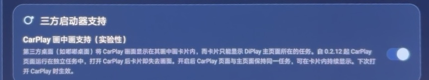

# DiPlay — community branch (FangJInGuang fork)

[English](README.md) · [简体中文](README.zh-CN.md) · [繁體中文](README.zh-TW.md)

**CarPlay for compatible BYD Android head units. This fork adds ONE experimental feature on top of the official [DiPlay](https://github.com/shihabal3amri/DiPlay) (v0.2.21).**

> **This is a community fork, not the official release.** Upstream: [shihabal3amri/DiPlay](https://github.com/shihabal3amri/DiPlay) · Feature PR: [#1081](https://github.com/shihabal3amri/DiPlay/pull/1081)

## Added feature: CarPlay picture-in-picture support (experimental)

**Settings → Advanced → Third-party launcher support → CarPlay picture-in-picture support (experimental)** — off by default.

Third-party desktops (e.g. Dudu desktop) embed DiPlay's main task in their picture-in-picture card. Since upstream 0.2.12 the CarPlay screen runs in a task of its own (`taskAffinity="${applicationId}.carplay"`), so the card loses the CarPlay picture as soon as it opens. When this switch is on, the CarPlay screen runs in the main page's task, so the card keeps showing it (pre-connect → connecting → CarPlay).

- Implementation: a second activity class (`CarPlayHostActivityMainTask`, no taskAffinity) + a single launch route used by all entry points + an `onCreate` guard for un-routed launches (USB attach, external component names). `taskAffinity` cannot be changed at runtime and an activity-alias cannot express a different affinity (AOSP `PackageParser.parseActivityAlias` inherits the target's affinity), so a real second class is required.
- Takes effect the next time CarPlay opens.
- **Pair with the existing "Picture-in-picture & split-screen adaptation" (adapt_pip_resolution)** for an adaptive canvas (no black bars).

### Vehicle test

- **Passed** on a **BYD Destroyer 05 (13.1 system, DiLink 3.0)** with **Dudu desktop (BYD edition)**: with the switch on, the pre-connect, connecting and CarPlay screens can all be displayed inside the card.
- Expected behaviors (not regressions): tapping "Connect now" briefly leaves the card (press back to re-embed); opening full screen from the launcher, resizing the card, or switching full-screen ⇄ picture-in-picture triggers a CarPlay reconnect (the existing canvas/display-change behavior of upstream, unrelated to this change).
- Experimental: validated on this vehicle + launcher only.

On-vehicle screenshots (Dudu desktop):

## Everything else

All other code, settings, docs and app behavior are identical to upstream [v0.2.21](https://github.com/shihabal3amri/DiPlay/releases/tag/v0.2.21).

- Install & connect: [docs/INSTALL.md](docs/INSTALL.md)
- Build from source: [docs/BUILD.md](docs/BUILD.md)
- Compatibility: [docs/COMPATIBILITY.md](docs/COMPATIBILITY.md)
- Diagnostics & privacy: [docs/PRIVACY.md](docs/PRIVACY.md)

> **No accessory (MFI) identity is stored in this repository**, per the upstream build rules; source/CI builds omit runtime identity assets by default. See the upstream build instructions for local release packaging.
