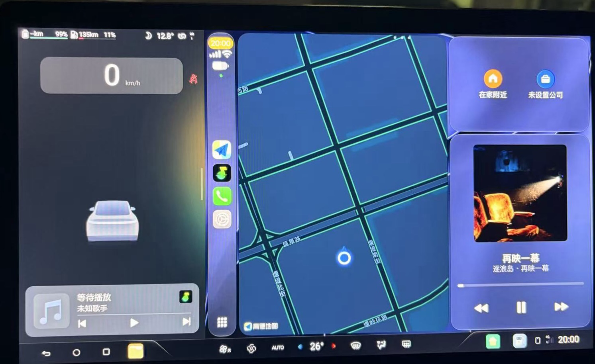
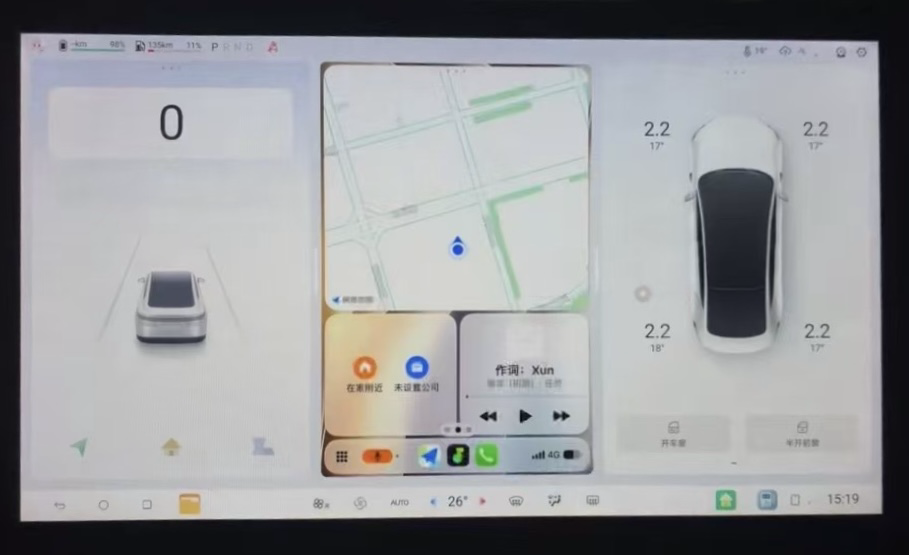

# DiPlay — 社群分支（FangJInGuang fork）

[English](README.md) · [简体中文](README.zh-CN.md) · [繁體中文](README.zh-TW.md)

**適用於比亞迪 Android 車機的 CarPlay 投影。本分支在官方 [DiPlay](https://github.com/shihabal3amri/DiPlay)（v0.2.21）基礎上，僅增加一項實驗性功能。**

> **本倉庫為社群分支，非官方發佈版。** 上游：[shihabal3amri/DiPlay](https://github.com/shihabal3amri/DiPlay) · 功能合併請求：[#1081](https://github.com/shihabal3amri/DiPlay/pull/1081)

## 新增功能：CarPlay 畫中畫支援（實驗性）

**設定 → 進階 → 第三方啟動器支援 → CarPlay 畫中畫支援（實驗性）** —— 預設關閉。

第三方桌面（如嘟嘟桌面）的畫中畫卡片只能顯示 DiPlay 主頁面所在的工作（Task）。自上游 0.2.12 起 CarPlay 畫面運行在獨立工作中（`taskAffinity="${applicationId}.carplay"`），開啟 CarPlay 後卡片即失去畫面。開啟本開關後，CarPlay 頁面與主頁面保持同一工作，卡片可在預連接 → 正在連接 → CarPlay 全程持續顯示。

- 實作方式：新增第二個 Activity 類（`CarPlayHostActivityMainTask`，無 taskAffinity）+ 統一啟動路由（涵蓋全部啟動入口）+ onCreate 守衛（兜底 USB 直連、外部明確指定元件等繞過路由的入口）。`taskAffinity` 為編譯期靜態屬性，執行時無法修改；activity-alias 也無法表達不同親和性（AOSP `PackageParser.parseActivityAlias` 強制繼承目標工作的親和性），因此必須使用真實的第二個類別。
- 下次開啟 CarPlay 時生效。
- **需配合官方既有的「畫中畫與分割畫面自適應」（adapt_pip_resolution）開關**，以獲得自適應畫布、無黑邊。

### 實車驗證

- **比亞迪驅逐艦 05（13.1 系統 / DiLink 3.0）+ 嘟嘟桌面（比亞迪專用版）驗證通過**：開啟開關後，預連接、正在連接、CarPlay 畫面均可在卡片內顯示。
- 預期現象（非回歸）：點「立即連接」會短暫跳出卡片（按返回鍵重新嵌入）；透過嘟嘟開啟全螢幕、拖動卡片大小、全螢幕 ⇄ 畫中畫切換會觸發 CarPlay 重連（屬上游既有畫布/顯示變更機制，與本改動無關）。
- 實驗性標註：僅在該車型 + 該桌面驗證，其他裝置相容性持續追蹤。

上車實拍（嘟嘟桌面）：

## 其餘部分

其餘程式碼、設定、文件與應用程式行為與上游 [v0.2.21](https://github.com/shihabal3amri/DiPlay/releases/tag/v0.2.21) 完全一致。

- 安裝與連接：[docs/INSTALL.md](docs/INSTALL.md)
- 原始碼建置：[docs/BUILD.md](docs/BUILD.md)
- 相容性與排障：[docs/COMPATIBILITY.md](docs/COMPATIBILITY.md)
- 診斷與隱私：[docs/PRIVACY.md](docs/PRIVACY.md)

> **本倉庫不含任何配件（MFI）身分資產**（遵循上游建置規範）；原始碼/CI 建置預設不含執行時身分資產，本機發佈打包方式見上游建置說明。
